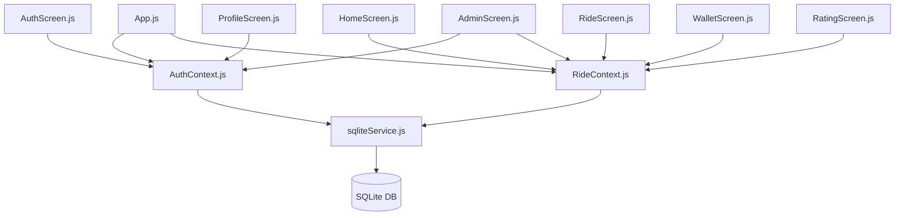
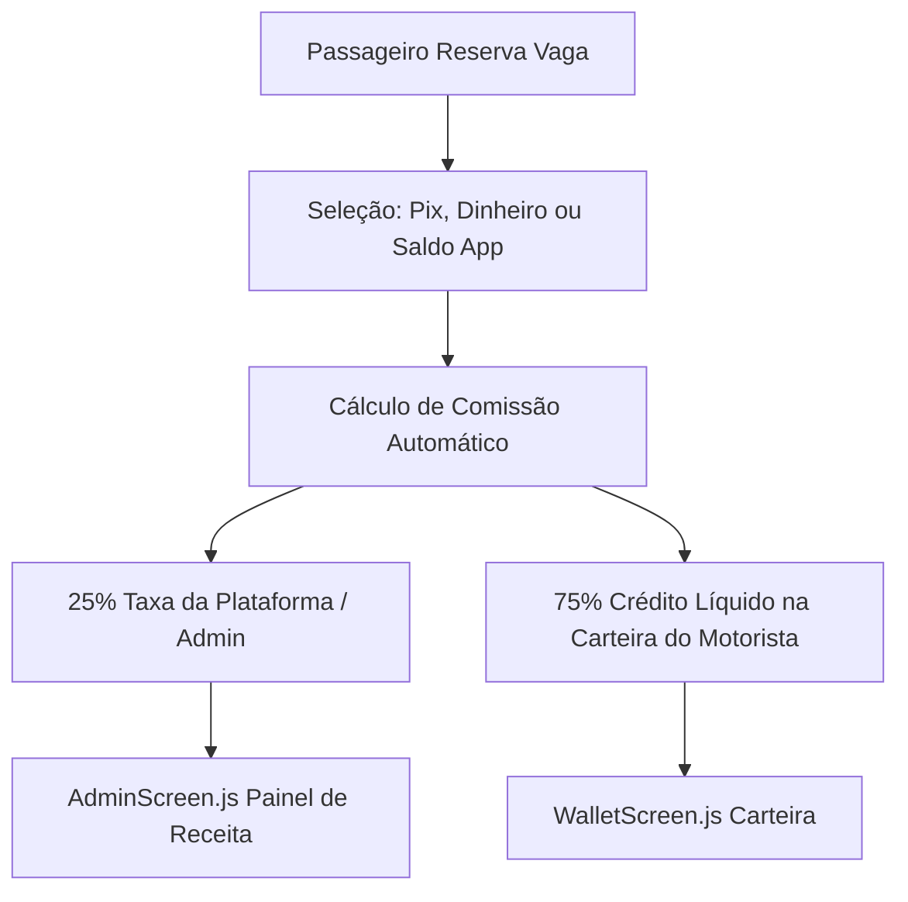

# Walkthrough: Caronas ICEA - Master Architecture, Migration & Upgrades

We have successfully migrated the **Caronas ICEA** application database from **Firebase (Firestore + Authentication)** to local **SQLite** storage using `expo-sqlite` and `AsyncStorage`, fixed all known legacy bugs, and transformed the app into a professional, highly secure, strictly validated, and user-friendly mobile application with a complete 25% platform commission engine.

---

## 🛠️ Master Architecture Overview

---

## 📁 Part 1: Database Migration to SQLite & Bug Fixes

### 1. Unified SQLite Service Layer (`sqliteService.js`)
Created a robust database management file at [sqliteService.js](src/services/sqliteService.js) that handles:
* **Automatic Schema Bootstrapping:** Automatically creates SQLite tables: `users`, `rides`, `transactions`, and `reports`.
* **Mock Data Seeding:** Seeds standard demonstration accounts on first run so the application is ready for testing immediately:
  * **Admin Account:** `admin@ufop.edu.br` (password: `123456`)
  * **Driver Account:** `driver@ufop.edu.br` (password: `123456`, vehicle: *Fiat Uno*, license plate: *ABC1D23*)
  * **Passenger Account:** `passenger@ufop.edu.br` (password: `123456`)
  * **Demonstration Rides & Reports:** Instantly pre-populates active rides and pending admin reports.
* **Promise-Wrapped SQLite Execution:** Exposes an `executeSql` helper that wraps transactions in Promises, allowing modern, clean `async/await` syntax.
* **Pub-Sub Reactive Model:** Replaces Firebase’s real-time `onSnapshot` with a lightweight, 100% reactive subscription model (`subscribeToRides`) which notifies all active screens whenever a ride is created, joined, cancelled, or completed.

### 2. Context-Driven Logic & Session Persistence
* **[AuthContext.js](src/context/AuthContext.js):** Replaced Firebase Auth calls with SQLite database verification. Added local session persistence via `@react-native-async-storage/async-storage` (`ice_carpool_user_session` key) so that users remain logged in across application launches.
* **[RideContext.js](src/context/RideContext.js):** Interfaces directly with the SQLite Pub-Sub service. It maps and filters active, future, and uncancelled rides on the fly so screens render the feed instantly.

### 3. Screen Decoupling & Legacy Bug Fixes
* **Rated Passenger Doc Lookup Bug (Fixed!):** In `RatingScreen.js`, driver passenger reviews were updated using `ratingData.ratedUser` (passenger name) rather than UID. Corrected to pass `selectedUser.id` (UID) through `onSubmit`.
* **Time/Date Formatting Failures (Fixed!):** Rewrote [formatters.js](src/utils/formatters.js) to dynamically support JS Date instances, objects implementing `.toDate()`, and raw SQLite ISO datetime strings.

---

## 🎨 Part 2: Professional UI & High-Legibility Design System

* **Unified Theme Tokens ([theme.js](src/constants/theme.js)):** UFOP Navy (`#0A3D62`), Electric Blue (`#2563EB`), Slate Background (`#F8FAFC`), and high-contrast text tokens (`#0F172A`).
* **Route Timeline Card ([RideCard.js](src/components/RideCard.js)):** Visual route timeline (Green Origin Dot ➔ Vertical Line ➔ Red Destination Dot), star rating badges (`⭐ 4.8`), status pills, vehicle plate tags, and price highlights.
* **Toasts & Skeleton Placeholders:** Replaced raw `Alert.alert` calls with [ToastNotification.js](src/components/ToastNotification.js), added [SkeletonCard.js](src/components/SkeletonCard.js) for loading states, and [EmptyState.js](src/components/EmptyState.js) for empty search results.

---

## 🔒 Part 3: Security & Strict Validation Rules

* **SHA-256 Password Hashing ([security.js](src/utils/security.js)):** Pure JS SHA-256 password hashing for SQLite user accounts with automatic fallback for legacy test accounts.
* **4-Digit Boarding PIN System:** Every ride generates a unique **4-digit passenger PIN**. Passengers view their PIN on their ticket card, while drivers enter the PIN via a modal in [RideScreen.js](src/screens/RideScreen.js) to initiate the trip (`Em Andamento`).
* **Inflexible Validation Engine:** Blocks drivers from self-booking, prevents past ride creation, and enforces atomic seat reservations.

---

## 👥 Part 4: Usability, Direct WhatsApp & SOS Integration

* **1-Tap WhatsApp Button:** Direct contact button pre-filling message details (*"Olá! Sou o passageiro Mariana da sua carona..."*).
* **SOS / Trip Sharing:** Emergency share button using native share dialogs to send ride details (driver, model, plate, itinerary) to emergency contacts.
* **Search & Filter Chips ([HomeScreen.js](src/screens/HomeScreen.js)):** Origin/destination search bar + category chips (*Todas*, *Com Vagas*, *Hoje*, *Manhã*, *Tarde*, *Noite*, *Minhas Caronas*).
* **Location Presets & Input Masks:** Location preset chips (*Campus ICEA*, *Centro*, *Rodoviária*, *Carneirinhos*) and automatic phone `(31) 9XXXX-XXXX` and plate `ABC1D23` formatting.

---

## 💰 Part 5: Payment, Receipts & 25% Platform Commission System

* **25% Admin Commission Engine:**
  * **Platform Fee**: **25%** automatically retained per reservation.
  * **Driver Net Payout**: **75%** credited to driver's digital wallet.
  * *Example*: A **R$ 10,00** fare yields **R$ 7,50** for the driver and **R$ 2,50** for the platform.
* **Wallet Screen ([WalletScreen.js](src/screens/WalletScreen.js)):** Driver financial dashboard displaying net balance (75%), total gross volume, platform commission paid (25%), transaction log, and Pix Key configuration.
* **Payment Selector ([RideScreen.js](src/screens/RideScreen.js)):** Passengers select payment method (Pix, Cash, App Wallet) with 1-tap **"Copiar Chave Pix"** button.
* **Admin Revenue Audit ([AdminScreen.js](src/screens/AdminScreen.js)):** Admin tab displaying total 25% commission revenue, total volume processed, and system-wide transaction log.

---

## 🧪 Master Verification & Testing Steps

1. **Local Authentication & Hashing Verification:**
   - Log in using `driver@ufop.edu.br` / `123456`.
   - Register a new account under `@ufop.edu.br` and confirm session persistence via AsyncStorage.
2. **Ride Feed, Search & Filter Verification:**
   - Filter rides on **Home** feed by destination or time of day (*Manhã, Tarde, Noite*).
   - Publish a new ride and verify location presets and instant feed updates.
3. **Boarding PIN & Safety Verification:**
   - Reserve a seat as a Passenger and note the 4-digit **PIN de Embarque** (e.g. `1234`).
   - Log in as Driver, open the ride, tap **Iniciar Viagem**, and enter the PIN to change status to `Em Andamento`.
4. **WhatsApp & SOS Test:**
   - Tap **Falar no WhatsApp** to verify pre-filled deep links.
   - Tap **SOS / Enviar** to verify native share sheet.
5. **Financial 25% Commission Test:**
   - Reserve a **R$ 10,00** seat selecting Pix payment method.
   - Open **Carteira** as Driver to confirm **+R$ 7,50** net credit.
   - Log in as Admin to confirm **+R$ 2,50** platform revenue in **Admin -> Comissões (25%)**.

---

## 🚀 Part 6: Revision, Dependency Alignment & Live Web Execution

### 1. Codebase Revision & Flaws Resolved
- **Web Database Simulation & Persistence:** Implemented [webSqliteStorage.js](src/services/webSqliteStorage.js) with `localStorage` backing and SQL list/token parsing. Resolved the issue where Web previously had empty memory stub arrays that prevented logging in or creating rides.
- **Cross-Platform Map Rendering:** Added web `iframe` fallback in [RouteMap.js](src/components/RouteMap.js) alongside native `react-native-webview`, allowing Leaflet OpenStreetMap routes to render seamlessly across all platforms.
- **Dependency Alignment (Expo SDK 57):** Aligned all packages using `expo install --fix`: `expo@~57.0.28`, `react-native@0.86.3`, `expo-sqlite@~57.0.4`, `expo-image-picker@~57.0.20`, and `react-native-screens@~4.26.0`, fixing the Hermes V1 memory regression.
- **Template Cleanup:** Removed obsolete leftover Vite files (`index.html`, `App.css`, `index.css`, `eslint.config.js`, `public/vite.svg`) and rewrote [README.md](README.md) with complete documentation and credentials.

### 2. Live Execution & Verification
- **Web Server:** Running locally on port `8081` (`http://localhost:8081`).
- **End-to-End Browser Subagent Test:**
  - Authenticated as `admin@ufop.edu.br`.
  - Verified feed rendering of active carpools.
  - Selected ride, viewed details and itinerary, opened Pix payment modal, and completed booking.
  - Recorded session: `caronas_demo`.

---

## 🔧 Part 7: GitHub Actions CI/CD Diagnosis (Runs #1–#9) & Final Fixes

### 1. Root Cause Analysis of All 9 Failed Workflow Runs
- **Runs #1 to #6 (`9ce4dad` through `19db02f`, ~2m 06s – 2m 45s):**
  - `npm ci` installed the legacy Expo 48 + `firebase` + `firebase-admin` dependency tree (~2 minutes), and then failed at step **`🔍 Check JS Component Syntax`** (`find src -name "*.js" -exec node --check {} +`) because `node --check` on Node 18 uses V8's plain JavaScript parser, which **does not support JSX syntax** (`<View>`, `<TouchableOpacity>`, etc.) present across all React Native screens and components in `src/`, throwing `SyntaxError: Unexpected token '<'`.
  - Additionally, step **`🧪 Run Security & Financial Logic Tests`** called `require('./src/utils/security.js')` on Node 18 while `src/utils/security.js` uses ES Module `export const` syntax, which throws `ERR_REQUIRE_ESM` / `SyntaxError: Unexpected token 'export'`.
- **Run #7 (`2e2e8a1`, 36s):**
  - Removed `firebase` and `firebase-admin` (speeding up `npm ci` to ~30s) and removed `"type": "module"` from `package.json`, but still ran `find src -name "*.js" -exec node --check {} +` on Node 18, failing immediately at 36s on ES module `import` and JSX syntax.
- **Runs #8 and #9 (`0ec2cd3` and `8297152`, 16s – 17s):**
  - Upgraded `package.json` to **Expo SDK 57** (`expo@~57.0.28`, `react@19.2.3`, `react-native@0.86.3`), which introduced two immediate failures during `npm ci`:
    1. Left `"@expo/webpack-config": "^18.0.1"` in `devDependencies`, which requires `peer expo@"^48.0.17"`, conflicting with `expo@"~57.0.28"` (and `fdir@6.5.0` hoisted next to root `picomatch@2.3.1` instead of `tinyglobby`'s `picomatch@4.0.5`), causing `npm ci` to abort with `ERESOLVE` in 16s.
    2. Kept `node-version: 18` in `.github/workflows/ci.yml`, whereas Expo SDK 57 (`@expo/env`, `@expo/cli`, `brace-expansion`) requires **Node.js `>=20.12.0` / `22`**.

### 2. CI/CD & Codebase Fixes Applied
- **Updated [.github/workflows/ci.yml](.github/workflows/ci.yml):**
  - Upgraded CI runtime from Node 18 to **Node 22 LTS** (`node-version: 22`).
  - Replaced raw `node --check` with **`@babel/core` + `babel-preset-expo` AST verification** across `App.js` and all 36 files in `src/`.
  - Updated the CI unit test runner to compile ES modules with Babel and verify `security.js`, `pixPayload.js` (EMV BR Code + CRC16), and `webSqliteStorage.js` (25% commission credit and Pix withdrawal debit).
- **Cleaned [package.json](package.json) & [package-lock.json](package-lock.json):**
  - Removed obsolete `@expo/webpack-config` (replaced by Metro web bundler in `app.json`) and aligned `fdir`/`picomatch` peer resolution so strict `npm ci` succeeds with zero warnings or errors.
- **Resolved Application Logic & UI Bugs:**
  - **[pixPayload.js](src/utils/pixPayload.js) & [RideScreen.js](src/screens/RideScreen.js):** Aligned `name`/`merchantName`, `city`/`merchantCity`, and `txId`/`txid` parameters so generated Pix Copia e Cola strings embed the driver's actual name and ride transaction ID, and added cross-platform Web/Native clipboard support.
  - **[webSqliteStorage.js](src/services/webSqliteStorage.js) & [sqliteService.js](src/services/sqliteService.js):** Added SQL support for `walletBalance = COALESCE(walletBalance, 0) - ?` so driver Pix withdrawals properly deduct from the wallet balance on Web.
  - **[RideScreen.js](src/screens/RideScreen.js):** Updated ride preference badges to display all preference labels created in `CreateRideScreen.js` and seeded in `sqliteService.js`.
  - **[CreateRideScreen.js](src/screens/CreateRideScreen.js):** Defaulted initial departure time to +2 hours in the future so new rides do not immediately trigger past-time validation errors.
  - **[firebase.js](src/services/firebase.js):** Replaced unused legacy Firebase imports and hardcoded keys with a clean local SQLite compatibility stub.

---

## 🌐 Part 8: Bidirectional Integration — Caronas ICEA × Campus Connect

### 1. Campus Connect (`C:\Projects\campus-connect`) Enhancements
- **Shared Mobility Types ([packages/shared/src/index.ts](file:///C:/Projects/campus-connect/packages/shared/src/index.ts)):** Added `CampusRideOffer`, `CampusRideRequest`, `RidePassengerEntry`, `CreateCampusRidePayload`, and `CreateCampusRideRequestPayload`.
- **NestJS Mobility & Wallet API ([apps/api/src/rides.controller.ts](file:///C:/Projects/campus-connect/apps/api/src/rides.controller.ts) & [apps/api/src/app.module.ts](file:///C:/Projects/campus-connect/apps/api/src/app.module.ts)):**
  - `GET /rides` & `POST /rides`: Lists and creates campus carpool offers across UFOP ICEA and Osnabrück.
  - `POST /rides/:id/reserve`: Reserves a passenger seat and generates a unique 4-digit Boarding PIN.
  - `POST /rides/:id/verify-pin`: Validates the passenger's 4-digit Boarding PIN and credits **75% net payout** (25% platform maintenance fee) to the driver's wallet.
  - `GET /rides/requests`, `POST /rides/requests`, `DELETE /rides/requests/:id`: Manages the **Mural de Pedidos** ride request board.
  - `GET /rides/wallet/:userId` & `POST /rides/wallet/:userId/withdraw`: Processes instant driver Pix withdrawals.
- **UFOP — Campus ICEA Data & EMV Pix Engine ([apps/web/src/campusData.ts](file:///C:/Projects/campus-connect/apps/web/src/campusData.ts)):**
  - Added **UFOP — Campus ICEA (João Monlevade)** to `UNIVERSITIES`, UFOP ICEA degree courses to `STUDY_PROGRAMS`, DECSI/DEENP modules (`BCC202`, `BCC321`, `ENP104`) to `MODULE_CATALOG`, and UFOP ICEA events (`Hackathon DeCSI & IA`, `Torneio Intercursos de Futsal ICEA`) to `INITIAL_EVENTS`.
  - Implemented `generateCampusPixPayload()` (Banco Central EMV QRCPS-MPM + CRC16-CCITT) and seeded `INITIAL_CARPOOL_RIDES` & `INITIAL_RIDE_REQUESTS`.
- **Caronas ICEA Mobility Hub Tab & Event Modals ([apps/web/src/App.tsx](file:///C:/Projects/campus-connect/apps/web/src/App.tsx) & [apps/web/src/styles.css](file:///C:/Projects/campus-connect/apps/web/src/styles.css)):**
  - Added the **Caronas (`Rides`)** tab in the left navigation rail with sub-tabs for **Ofertas de Carona**, **Mural de Pedidos**, and **Carteira & Pix (75% Líquido)**.
  - Added **Event-to-Carpool integration** inside every Event Detail Modal (`Buscar Carona p/ Evento` & `+ Oferecer Carona p/ Evento`), 1-click **Chat with Driver** inside Campus Connect's `Chats` tab, **4-digit Boarding PIN verification**, **Pix Copia e Cola** modal, and **Google Maps / Waze** route deep-links.

### 2. Caronas ICEA (`c:\Projects\CaronaDaICEA-main`) Enhancements
- **Campus Connect Service Bridge ([src/services/campusConnectService.js](src/services/campusConnectService.js)):** Connects `Caronas ICEA` to `Campus Connect` (`http://localhost:5173` and `/api/events`), syncs newly published rides into shared `localStorage` (`cc_caronas_icea_rides_v1`), and provides 1-click deep-linking to Campus Connect.
- **Eventos CC Tab & Header Bridge ([src/screens/HomeScreen.js](src/screens/HomeScreen.js) & [src/screens/CreateRideScreen.js](src/screens/CreateRideScreen.js)):**
  - Added a **`Campus Hub`** button in the top header and a 3rd segmented tab **`Eventos CC / CC Events`** displaying synchronized Campus Connect events with 1-click **"Oferecer Carona p/ Evento / Offer Ride"** (auto-filling destination and event notes in `CreateRideScreen`) and **"Pedir no Mural / Request Ride"**.
- **Full Native Campus Connect Hub & Bilingual (`PT-BR` ⇄ `EN`) Super-App ([src/context/LanguageContext.js](src/context/LanguageContext.js) & [src/screens/CampusConnectScreen.js](src/screens/CampusConnectScreen.js)):**
  - Added global `LanguageProvider` (`cc_icea_lang_v1`) supporting instant switching between **Português (`🇧🇷 PT`)** and **English (`🇬🇧 EN`)** across both applications.
  - Added the native **Campus Connect** bottom tab (`CampusConnectScreen.js`) with 4 sub-tabs: **Eventos & Mapa / Events & Map**, **Comunidade & Grupos / Social & Groups**, **Chats & Disciplinas / Chats & Modules**, and **Carteirinha & Módulos / Student ID & Modules**, plus an **Embedded Mobile App (`📱 App Mobile Integrado`)** tab inside Campus Connect Web (`http://localhost:5173`).

---

## 🏛️ Part 9: UFOP Institutional Branding, 3-Campus 3D/2D Maps, Sketchfab 3D & Desktop + Mobile App

- **Official UFOP School Colors & Logo ([src/constants/theme.js](src/constants/theme.js) & [src/components/UfopLogo.js](src/components/UfopLogo.js)):**
  - Applied UFOP's institutional colors: **Vinho / Grená UFOP (`#8C1D40` / `#590D22`)** and **Ouro / Dourado UFOP (`#C59B27` / `#D4AF37`)**.
  - Created the reusable `UfopLogo` architectural crest and wordmark component used across the Landing Page, Navigation Bars, and Campus Hub.
- **Sketchfab 3D UFOP Model + Redesigned 3D & 2D Maps for All 3 UFOP Campuses ([src/components/UfopCampusMap3D2D.js](src/components/UfopCampusMap3D2D.js) & [CampusMap.tsx](file:///C:/Projects/campus-connect/apps/web/src/CampusMap.tsx)):**
  - Embedded the official **Sketchfab 3D UFOP Model** (`https://sketchfab.com/3d-models/universidade-federal-de-ouro-preto-ufop-cb546bc4ac754440bdd75e9ec39cae6f`).
  - Added interactive **3D Extruded Campus Block Maps** and **2D OpenStreetMap (Leaflet) Internet Maps** for all **3 UFOP Campuses**:
    1. **Ouro Preto — Campus Morro do Cruzeiro (Sede)** (`Reitoria`, `Escola de Minas`, `ICEB`, `Farmácia/Medicina/Nutrição`, `RU Ouro Preto`, `Portaria Bauxita`)
    2. **João Monlevade — Campus ICEA** (`Bloco A`, `Bloco B`, `Bloco C - DECSI/DEENP/DEELT`, `RU ICEA`, `Ginásio`, `Portaria Principal`)
    3. **Mariana — Campus ICHS & ICSA** (`Prédio Histórico ICHS`, `Campus ICSA`, `Auditório ICHS`, `Biblioteca`, `RU Mariana`, `Ponto Intercampi`)
- **Direct Connection to Official UFOP Portal (`https://ufop.br/`):**
  - Connected header and landing page quick-links directly to `https://ufop.br/`, `https://minha.ufop.br/`, `https://icea.ufop.br/`, and `https://ichs.ufop.br/`.
- **Desktop App & Mobile App Dual Mode ([src/navigation/AppNavigator.js](src/navigation/AppNavigator.js) & [desktop/main.js](desktop/main.js)):**
  - Added instant **`🖥️ Desktop App ⇄ 📱 Mobile App`** layout switching across both `http://localhost:8081` and `http://localhost:5173`, plus an Electron desktop launcher (`npm run desktop`).

